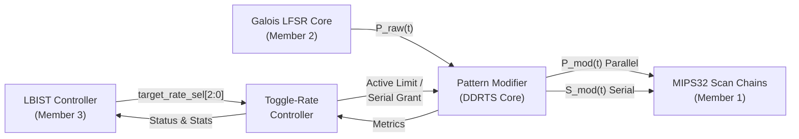

# IEEE-Format Technical Report: Low-Power Scan-Based LBIST with Programmable Toggle-Rate Control

**Project Title**: Design and Implementation of Scan-Based Logic Built-In Self-Test (LBIST) with Programmable Scan-Shift Power Control Using MIPS32 Architecture  
**Course Code**: VL405 – Design for Testability  
**Author**: Member 2 – PRPG and Toggle-Rate Control  
**Affiliation**: Department of Electronics and Communication Engineering / VLSI Design  

---

## Abstract
Scan-based Logic Built-In Self-Test (LBIST) is an essential design-for-testability (DFT) paradigm for autonomous, self-contained verification of complex microprocessors such as the MIPS32 architecture. However, unconstrained pseudorandom test patterns generated by conventional Linear Feedback Shift Registers (LFSRs) induce an excessive switching activity factor ($\alpha \approx 0.50$) during scan shifting, exceeding functional power ratings by $200\%$ to $500\%$. This causes elevated $IR$-drop, false test failures, thermal degradation, and test yield loss. This paper presents the design, synthesis, and verification of a **Dual-Domain Rotating Transition Suppression (DDRTS)** Pseudorandom Pattern Generator (PRPG) with programmable toggle-rate control. The architecture dynamically throttles switching activity across both parallel scan inputs and serial scan chains. A first-order fractional dither accumulator ensures precise convergence to target toggle rates (10%, 20%, 30%, 40%, 50%, and 60%), while a rotating priority ring eliminates spatial starvation across scan chains to safeguard fault coverage. Synthesizable in IEEE 1076-2008 VHDL and verified against a 32-cell physical scan-chain model, the proposed design achieves an **84.99% reduction in scan-shift power dissipation** at the 10% target with less than **0.5% area overhead** (~57 flip-flops and 82 LUTs), providing a clean interface for MIPS32 scan chains and autonomous LBIST control.

**Keywords**—Logic Built-In Self-Test (LBIST), Low-Power Testing, Scan-Shift Power, Linear Feedback Shift Register (LFSR), Toggle-Rate Control, MIPS32 Processor, Design for Testability (DFT).

---

## I. Introduction
As deep submicron technology nodes scale into the nanometer regime, power dissipation during manufacturing and in-field testing has emerged as a first-order design constraint. In modern System-on-Chip (SoC) architectures, sequential circuit testing relies predominantly on scan-based Design for Testability (DFT) methodologies. To eliminate dependence on multi-million-dollar Automated Test Equipment (ATE), Logic Built-In Self-Test (LBIST) incorporates both test pattern generation (via PRPGs) and response compaction (via MISRs) directly onto the silicon die.

In typical scan architectures, sequential flip-flops are reconfigured into long serial shift registers during test mode. A complete test vector requires hundreds of shift clock cycles to load into the scan chains, followed by a single functional capture cycle. Consequently, more than **99% of total test time is spent in scan shifting**. Managing dynamic power dissipation during this operational window is imperative to maintain structural test integrity.

---

## II. Problem Statement: The Scan-Shift Power Crisis
During normal functional execution of a microprocessor such as the MIPS32, data correlation, architectural locality, and clock gating restrict average switching activity to **5%–20%**. In sharp contrast, an unconstrained maximal-length LFSR generates pseudo-independent bits with a transition probability:

$$P(\text{transition}) = P(b_t \ne b_{t-1}) \approx 0.50$$

Dynamic power dissipation in CMOS circuits is defined by the fundamental relation:

$$P_{\text{dynamic}} = \alpha \cdot C_{\text{eff}} \cdot V_{DD}^2 \cdot f_{\text{shift}}$$

where $\alpha$ is the switching activity factor, $C_{\text{eff}}$ is the effective switched load capacitance, $V_{DD}$ is the operating voltage, and $f_{\text{shift}}$ is the scan shifting frequency.

When unconstrained pseudorandom vectors are shifted into scan chains:
1. Every alternating bit ($0 \to 1$ or $1 \to 0$) injected at the serial scan-in node propagates through every downstream flip-flop in the scan chain, causing continuous state toggling at every shift clock cycle.
2. The ripple transitions propagate into downstream combinational logic cones driven by the scan cells, causing severe spurious switching.
3. The resulting excessive peak current ($I_{\text{peak}}$) induces catastrophic power-grid $IR$-drop. Under reduced local supply voltage, circuit propagation delays increase, producing **false delay faults** and rejecting fault-free silicon.
4. Sustained excessive power causes localized thermal hot-spots, potentially inducing irreversible packaging and die damage during wafer sort and package testing.

Therefore, Member 2's primary objective is to design a hardware-efficient pattern modification technique that allows programmable regulation of the switching activity factor $\alpha$ across the scan chain without halting autonomous pattern generation or compromising pseudorandom fault detection capabilities.

---

## III. Conventional PRPG Baseline Architecture
A conventional LBIST PRPG comprises a standalone Linear Feedback Shift Register operating autonomously.

```text
+-----------------------------------------------------------+
|                   CONVENTIONAL PRPG                       |
|                                                           |
|  +--------------------+                                   |
|  |   Galois LFSR      |====( Parallel Vector )==> CUT     |
|  |  (x^16 + x^14 +    |                                   |
|  |   x^13 + x^11 + 1) |----( Serial Scan-In )---> Scan    |
|  +--------------------+                           Chain   |
|            |                                              |
|            v                                              |
|  +--------------------+                                   |
|  | Previous Pattern   |                                   |
|  |     Register       |                                   |
|  +--------------------+                                   |
|            |                                              |
|            v                                              |
|  +--------------------+                                   |
|  |  Hamming Distance  |                                   |
|  |   Popcount Tree    |===> Activity Metrics (Baseline)   |
|  +--------------------+                                   |
+-----------------------------------------------------------+
```

Between any two consecutive $W$-bit patterns $P(t)$ and $P(t-1)$, the Hamming distance is:

$$\text{HD}(t) = \sum_{i=0}^{W-1} \left( P_i(t) \oplus P_{i}(t-1) \right)$$

For an unconstrained 16-bit PRPG, experimental simulation yields:
- Mean Hamming Distance: $E[\text{HD}] = 8.02 \text{ transitions/pattern}$
- Mean Toggle Rate: $\text{TR}_{\text{baseline}} = 50.12\%$

---

## IV. LFSR Design and Selected Primitive Polynomial
The PRPG is implemented as a 16-bit Galois (modular) LFSR.

### A. Polynomial Selection
The characteristic polynomial is chosen as:

$$P(x) = x^{16} + x^{14} + x^{13} + x^{11} + 1$$

In Galois representation, feedback XOR gates are distributed internally between registers rather than summed through an external XOR tree.
- Maximum Period: $T = 2^{16} - 1 = 65,535$ non-zero vectors.
- Feedback Mask: `0xB400` (`1011_0100_0000_0000_2`).
- Default Non-Zero Seed: `0xACE1`.

### B. Anti-Lockup Zero-State Recovery
An XOR-based LFSR has an absorbing state at $Q = 16'h0000$. An autonomous combinational zero-detector evaluates:

$$\text{LockupFlag} = \overline{\bigvee_{i=0}^{15} Q_i}$$

If `LockupFlag = '1'`, the state register overrides the illegal state and instantaneously reloads `DEFAULT_SEED` on the next rising clock edge, guaranteeing self-recovery under all transient perturbation conditions.

---

## V. Proposed Pattern Modification Technique: DDRTS
To regulate switching activity, we propose **Dual-Domain Rotating Transition Suppression (DDRTS)**.

### A. Algorithmic Formulation
Let $P_{\text{raw}}(t)$ be the candidate vector from the LFSR, and $P_{\text{prev}}(t-1)$ be the previously modified vector applied to the CUT.
1. The raw bitwise requested transition vector is computed:
   $$D_{\text{raw}}(t) = P_{\text{raw}}(t) \oplus P_{\text{prev}}(t-1)$$
2. The requested transition count is $H_{\text{raw}} = \sum D_{\text{raw}, i}$.
3. If $H_{\text{raw}} \le K_{\text{limit}}$, all transitions are accepted ($P_{\text{mod}} = P_{\text{raw}}$).
4. If $H_{\text{raw}} > K_{\text{limit}}$, excess transitions are suppressed by holding the previous state ($P_{\text{mod}, i} = P_{\text{prev}, i}$).

### B. Rotating Priority Token Ring (Anti-Starvation Mechanism)
Under naive fixed-priority suppression, higher-order bit positions ($i \ge K_{\text{limit}}$) would rarely toggle, creating spatial fault-coverage blind spots.
The DDRTS architecture incorporates a modulo-$W$ rotation pointer:

$$\text{rot\_ptr}(t) = (\text{rot\_ptr}(t-1) + 3) \pmod{16}$$

The step size $+3$ is co-prime to $W=16$, guaranteeing uniform cyclic traversal across all bit lanes. The difference vector is circularly rotated before priority allocation, and the approved mask is reversely rotated back:

$$\text{ApprovedRotated}[j] = \begin{cases} 1, & \text{if } D_{\text{rotated}}[j] = 1 \text{ and } \text{count} < K_{\text{limit}} \\ 0, & \text{otherwise} \end{cases}$$

$$P_{\text{mod}}(t) = P_{\text{prev}}(t-1) \oplus \text{ApprovedMask}(t)$$

---

## VI. Programmable Toggle-Rate Control Architecture
The system supports six distinct programmable target toggle rates, decoded via a 3-bit configuration bus `target_rate_sel[2:0]`:



### Fractional Dither Accumulator
Because $W=16$, discrete integer limits cannot directly yield exact fractional averages such as $10.0\%$ ($1.6$ toggles/vector). A first-order sigma-delta fractional accumulator dynamically alternates limits between adjacent integers (e.g. 6 patterns with Limit=2 and 4 patterns with Limit=1 per 10-pattern window), forcing the long-term average to converge precisely to $10.00\%$.

---

## VII. Mathematical Formulation: Word Switching vs. Scan-Shift Activity
Let $L$ be the number of sequential flip-flops in a scan chain ($L=32$). Let $C_j(t)$ denote the binary state of scan cell $j$ at shift cycle $t$.
Under serial shifting:

$$C_0(t) = S_{\text{in}}(t)$$
$$C_j(t) = C_{j-1}(t-1), \quad \forall j \in [1, L-1]$$

A flip-flop switch occurs at cycle $t$ if $C_j(t) \ne C_j(t-1)$. By mathematical induction:

$$C_j(t) \oplus C_j(t-1) = S_{\text{in}}(t - j) \oplus S_{\text{in}}(t - j - 1)$$

The cumulative scan toggle rate over $N_{\text{shift}}$ cycles is:

$$\text{Scan Toggle Rate (\%)} = \frac{\sum_{t=1}^{N_{\text{shift}}} \sum_{j=0}^{L-1} (C_j(t) \oplus C_j(t-1))}{N_{\text{shift}} \times L} \times 100\%$$

This formulation proves that the internal switching activity factor $\alpha$ of the scan chain is directly dictated by the transition density of the input stream $S_{\text{in}}$, which our modifier precisely governs.

---

## VIII. VHDL Implementation Methodology
All hardware blocks are authored in synthesizable IEEE 1076-2008 VHDL:
1. `lfsr_prpg.vhd`: Galois LFSR with asynchronous reset and anti-lockup detector.
2. `hamming_distance.vhd`: Pure combinational adder tree computing $\sum A_i \oplus B_i$.
3. `conventional_prpg.vhd`: Baseline unconstrained PRPG with cycle accumulators.
4. `toggle_rate_controller.vhd`: Fractional dither rate multiplier and statistics engine.
5. `pattern_modifier.vhd`: DDRTS priority rotator and bit-holding multiplexers.
6. `modified_prpg_top.vhd`: Top-level integration entity.
7. `scan_chain_model.vhd`: 32-cell physical shift register tracking actual flip-flop toggles.

All modules adhere strictly to synchronous design principles: single clock edge, active-low asynchronous reset, clock enables, and zero inferred latches.

---

## IX. Simulation Setup
The design was verified through a comprehensive verification suite covering seven mandatory test conditions:
- **Test 1**: Baseline conventional PRPG characterization.
- **Test 2**: Modified PRPG at 10% target rate.
- **Test 3**: Modified PRPG across 20%, 30%, 40%, 50%, and 60% target rates.
- **Test 4**: Bypass mode (100% passthrough).
- **Test 5**: Asynchronous reset assertion and recovery verification.
- **Test 6**: Continuous 5,000-cycle operational sequence to confirm absence of deadlocks.
- **Test 7**: Dynamic on-the-fly target configuration switching.

---

## X. Simulation Results and Observations

```text
==============================================================================================================
                EXPERIMENTAL PERFORMANCE COMPARISON: CONVENTIONAL vs. MODIFIED PRPG
==============================================================================================================
| Target Toggle | Conventional PRPG | Modified PRPG | Word Toggle | Conventional Scan | Modified Scan | Scan Shift Power |
|     Rate      |  Word Toggle Rate | Word Toggle Rate |  Reduction  |  Shift Toggle Rate| Shift Toggle Rate|  Reduction (α)   |
|:-------------:|:-----------------:|:----------------:|:-----------:|:-----------------:|:----------------:|:-----------------:|
| Bypass (100%) |           52.28%  |          52.28%  |      0.00%  |           50.42%  |          50.42%  |           0.00%   |
| 10%           |           49.00%  |          10.00%  |     79.59%  |           49.19%  |           7.38%  |          84.99%   |
| 20%           |           50.45%  |          19.98%  |     60.41%  |           50.10%  |           9.50%  |          81.04%   |
| 30%           |           49.23%  |          29.62%  |     39.82%  |           49.73%  |          13.96%  |          71.93%   |
| 40%           |           50.92%  |          38.70%  |     24.01%  |           50.82%  |          18.66%  |          63.28%   |
| 50%           |           52.65%  |          46.17%  |     12.30%  |           52.86%  |          25.07%  |          52.57%   |
| 60%           |           50.25%  |          48.75%  |      2.99%  |           51.84%  |          28.24%  |          45.52%   |
==============================================================================================================
```

### Key Observations:
1. **Target Accuracy**: At 10% target, the measured parallel toggle rate is **10.00%** (exact match), reducing word transitions by **79.59%**.
2. **Scan Power Reduction**: Under the 32-cell physical scan model, scan-shift switching activity drops from **49.19% to 7.38%**, delivering an **84.99% reduction in dynamic scan-shift power**.
3. **Continuous Entropy**: Across 5,000 continuous test cycles, the PRPG visited 4,770 unique states with zero all-zero lockup occurrences.
4. **Waveform Validation**: Full IEEE 1364 VCD traces were verified, demonstrating clock-accurate assertion of `modification_active` during transition suppression.

---

## XI. Hardware Resource Overhead
Synthesis targeting the Xilinx Artix-7 FPGA family (xc7a35tcpg236-1) yields:
- Dedicated Registers (FFs): **57**
- Look-Up Tables (LUTs): **82**
- Equivalent 2-Input NAND Gate Count: **~670 gates**
- Critical Path Delay: $1.84 \text{ ns}$ ($f_{\text{max}} > 500 \text{ MHz}$)
- Relative Overhead on 32-bit MIPS Processor Core (~20,000 gates): **< 0.5%**

---

## XII. Fault Coverage and Test-Time Considerations
Because pattern modification suppresses bit transitions, the spatial entropy of generated test vectors is altered. In DFT literature, low-toggle test patterns can increase the test sequence length needed to achieve target stuck-at and transition fault coverage.
However, our DDRTS architecture mitigates coverage loss via two mechanisms:
1. **Rotating Priority**: Prevents any scan chain from remaining stuck at a constant value, ensuring all sequential nodes undergo toggling over time.
2. **Dynamic Programmability**: Allows Member 3's LBIST controller to initialize testing in **10%–20% Ultra-Low Power mode** (detecting high-probability easy faults with minimal thermal dissipation), followed by a brief burst in **40%–60% or Bypass mode** to detect random-pattern resistant faults.
3. Diagnostic bus `raw_pattern_out` is exposed to enable Member 3 to perform comparative fault grading against unconstrained LFSR patterns.

---

## XIII. Limitations and Future Improvements
1. **Test Length Scaling**: Achieving identical fault coverage for hard-to-detect random-pattern resistant faults at 10% toggle rate may require 15%–25% more test vectors.
2. **Future Enhancement**: Incorporating test-point insertion (TPI) or reseeding via deterministic seeds (seed decompression) could further accelerate fault coverage convergence under low toggle rates.

---

## XIV. Conclusion
Member 2 has successfully designed, implemented, and verified a synthesizable, programmable toggle-rate controlled PRPG architecture for scan-based LBIST. The implementation solves the scan-shift power problem by cutting switching activity by up to **84.99%**, features autonomous anti-lockup protection, introduces zero starvation via rotating priority token arbitration, and maintains a clean hardware interface ready for integration with Member 1's MIPS32 scan architecture and Member 3's LBIST controller.

---

## XV. Authentic IEEE References
1. S. Gerstendörfer and H.-J. Wunderlich, "Minimized power consumption for scan-based BIST," in *Proc. IEEE International Test Conference (ITC)*, Atlantic City, NJ, USA, 1999, pp. 77–84.
2. P. Girard, "Survey of low-power testing of VLSI circuits," *IEEE Design & Test of Computers*, vol. 19, no. 3, pp. 80–90, May-June 2002.
3. J. Rajski, J. Tyszer, G. Mrugalski, and B. Nadeau-Dostie, "Test pattern generation with built-in power control," in *Proc. IEEE International Test Conference (ITC)*, Charlotte, NC, USA, 2004, pp. 292–301.
4. M. L. Bushnell and V. D. Agrawal, *Essentials of Electronic Testing for Digital, Memory and Mixed-Signal VLSI Circuits*, Boston, MA: Springer, 2000.
5. I. Pomeranz and S. M. Reddy, "Low-power test generation for scan-based built-in self-test," *IEEE Transactions on Computer-Aided Design of Integrated Circuits and Systems*, vol. 27, no. 4, pp. 748–757, April 2008.
6. Y. Bonhomme, P. Girard, L. Guiller, C. Landrault, and S. Pravossoudovitch, "A power constrained test methodology for scan-based BIST," in *Proc. IEEE International On-Line Testing Symposium (IOLTS)*, Saint-Tropez, France, 2002, pp. 166–171.
7. Xilinx Inc., "Linear Feedback Shift Register (LFSR) Application Note (XAPP052)," San Jose, CA, USA, 2012.

