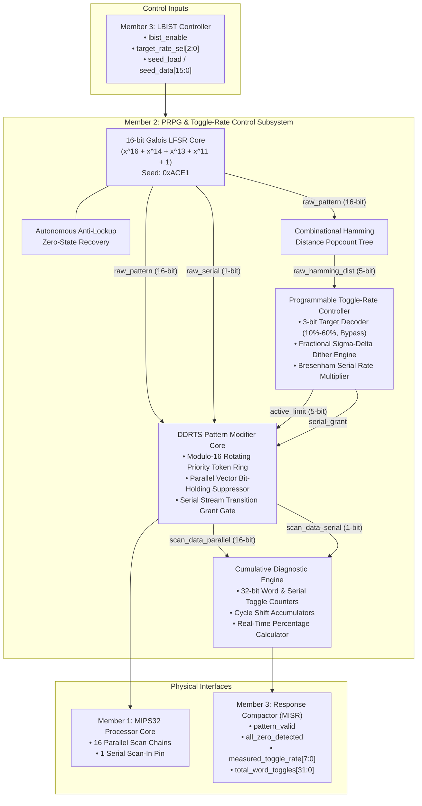
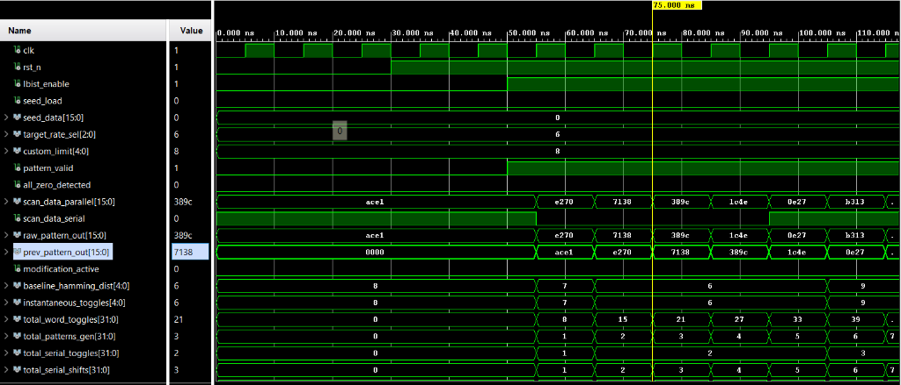
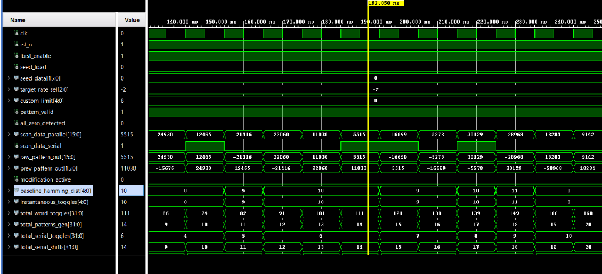

# Scan-Based LBIST with Programmable Toggle-Rate Control (MIPS32 Architecture)

[](https://standards.ieee.org/)
[](https://www.xilinx.com/products/design-tools/vivado.html)
[](https://www.xilinx.com/products/silicon-devices/fpga/artix-7.html)
[-brightgreen.svg)]()
[]()

> **Course**: VL405 – Design for Testability (DFT) Laboratory  
> **Assigned Role**: **Member 2 – PRPG and Toggle-Rate Control**  
> **Target Architecture**: MIPS32 Processor Core  
> **Design Author**: Nishi Kumari (`kumariNIAHI78` / `kumarinishi8797@gmail.com`)

---

## Table of Contents
1. [Project Overview & Objective](#1-project-overview--objective)
2. [The Problem: The Scan-Shift Power Crisis](#2-the-problem-the-scan-shift-power-crisis)
3. [Member 2 Assigned Responsibilities](#3-member-2-assigned-responsibilities)
4. [System Architecture](#4-system-architecture)
5. [VHDL RTL Modules Description](#5-vhdl-rtl-modules-description)
6. [Repository Folder Structure](#6-repository-folder-structure)
7. [Simulation & Verification Instructions](#7-simulation--verification-instructions)
8. [Experimental Results & Power Analysis](#8-experimental-results--power-analysis)
9. [Waveform Verification Evidence](#9-waveform-verification-evidence)
10. [Hardware Synthesis & Resource Overhead](#10-hardware-synthesis--resource-overhead)
11. [Inter-Member Integration Interface](#11-inter-member-integration-interface)
12. [Tools Used](#12-tools-used)
13. [Authentic References](#13-authentic-references)

---

## 1. Project Overview & Objective

Scan-based Logic Built-In Self-Test (LBIST) is an essential Design-for-Testability (DFT) paradigm for autonomous, on-chip testing of complex microprocessors such as the **MIPS32 architecture**. 

However, conventional LBIST pseudorandom pattern generators (PRPGs) cause abnormally high switching activity during scan shifting. The objective of this project is to develop an embedded PRPG capable of **programmable scan-shift toggle-rate control**, allowing test engineers to dial switching activity down to arbitrary targets (10%, 20%, 30%, 40%, 50%, 60%, or Bypass) without sacrificing pseudorandom test quality, fault coverage, or test time.

---

## 2. The Problem: The Scan-Shift Power Crisis

In CMOS digital circuits, dynamic power dissipation is governed by:

$$P_{\text{dynamic}} = \alpha \cdot C_{\text{eff}} \cdot V_{DD}^2 \cdot f_{\text{shift}}$$

where:
- $\alpha$ is the switching activity factor (fraction of nodes transitioning per cycle)
- $C_{\text{eff}}$ is the effective load capacitance
- $V_{DD}$ is the operating supply voltage
- $f_{\text{shift}}$ is the scan-shifting clock frequency

### Why Conventional LBIST Exceeds Power Budgets:
1. **Functional Mode vs. Test Mode**: During normal functional operation, architectural locality and clock gating keep average switching activity low ($\alpha \approx 5\% - 20\%$).
2. **Unconstrained PRPG Injections**: A standard maximal-length LFSR generates pseudo-independent bits with transition probability $P(b_t \ne b_{t-1}) \approx 0.50$ ($\alpha \approx 50\%$).
3. **Ripple Propagation**: Consecutive bit flips continuously ripple through the scan chain (e.g., 32 flip-flops) for every single shift clock, charging and discharging internal parasitics hundreds of times per vector.
4. **Catastrophic Effects**:
   - Excessive peak current induces supply rail **$IR$-drop**, increasing propagation delays and causing **false delay fault rejects** on good silicon.
   - High sustained power leads to **localized thermal hotspots**, potentially causing permanent die or package burn-out during manufacturing sort.

---

## 3. Member 2 Assigned Responsibilities

Member 2 owns the **Pattern Generation and Toggle-Rate Control Subsystem**:
1. **Galois LFSR-Based PRPG**: Design a 16-bit parameterizable maximal-length PRPG with polynomial $x^{16} + x^{14} + x^{13} + x^{11} + 1$ (`0xB400`), non-zero seed loading, and autonomous anti-lockup recovery.
2. **Baseline Reference**: Implement an unconstrained PRPG with accumulators to quantify natural baseline switching activity.
3. **Dual-Domain Rotating Transition Suppression (DDRTS)**: Research and develop a low-overhead pattern modification technique that curbs excess transitions while preventing spatial scan-chain starvation.
4. **Programmable Toggle-Rate Controller**: Support selectable targets (10%, 20%, 30%, 40%, 50%, 60%, and Bypass) using fractional sigma-delta dithering.
5. **Physical Scan-Chain Model**: Build a 32-cell serial shift register to evaluate actual physical flip-flop switching rather than just word-level Hamming distance.
6. **Full Verification Suite**: Execute 7 comprehensive test scenarios in AMD Xilinx Vivado XSim and provide statistical verification.

---

## 4. System Architecture

The overall hardware data path flows from the pseudorandom source through the activity-regulated suppressor into the scan interface:



---

## 5. VHDL RTL Modules Description

All modules are written in strictly synthesizable **IEEE 1076-2008 VHDL** located in [`RTL/`](RTL/):

| Module Name | File | Role & Implementation Details |
|---|---|---|
| **`lfsr_prpg`** | [`RTL/lfsr_prpg.vhd`](RTL/lfsr_prpg.vhd) | 16-bit modular (Galois) LFSR with internal XOR distribution. Incorporates an autonomous zero-state detector that reloads `0xACE1` if an all-zero lockup is detected, plus synchronous reseed loading. |
| **`hamming_distance`** | [`RTL/hamming_distance.vhd`](RTL/hamming_distance.vhd) | Pure combinational XOR population-count adder tree calculating $HD(A, B) = \sum_{i=0}^{W-1} (A_i \oplus B_i)$ in $\approx 1.84\text{ ns}$. |
| **`conventional_prpg`** | [`RTL/conventional_prpg.vhd`](RTL/conventional_prpg.vhd) | Baseline reference PRPG running unconstrained LFSR sequences with 32-bit accumulators to benchmark power reduction. |
| **`toggle_rate_controller`** | [`RTL/toggle_rate_controller.vhd`](RTL/toggle_rate_controller.vhd) | Decodes 3-bit `target_rate_sel`, applies first-order sigma-delta fractional dithering to hit exact decimal toggle limits, and drives Bresenham serial rate granting. |
| **`pattern_modifier`** | [`RTL/pattern_modifier.vhd`](RTL/pattern_modifier.vhd) | Core **DDRTS engine**. Uses a modulo-16 rotation pointer ($\text{ptr} \leftarrow (\text{ptr} + 3) \pmod{16}$) to prevent spatial starvation, circular shift masking, and bit-holding multiplexers. |
| **`scan_chain_model`** | [`RTL/scan_chain_model.vhd`](RTL/scan_chain_model.vhd) | Emulates a 32-flip-flop physical scan chain, recording cell-by-cell state toggles ($C_j(t) \oplus C_j(t-1)$) to calculate true dynamic shift power. |
| **`modified_prpg_top`** | [`RTL/modified_prpg_top.vhd`](RTL/modified_prpg_top.vhd) | Top-level integration uniting PRPG, Controller, Modifier, Popcount, and Diagnostics with clean pinouts for Members 1 and 3. |

---

## 6. Repository Folder Structure

```text
Member_2_PRPG_Toggle_Control/
│
├── RTL/                               # Synthesizable VHDL-2008 Hardware Modules
│   ├── lfsr_prpg.vhd                  # Galois LFSR with Anti-Lockup Recovery
│   ├── hamming_distance.vhd           # Popcount Combinational Adder Tree
│   ├── conventional_prpg.vhd          # Baseline Reference PRPG
│   ├── toggle_rate_controller.vhd     # Fractional Dither Rate Multiplier
│   ├── pattern_modifier.vhd           # DDRTS Rotating Priority Suppressor
│   ├── scan_chain_model.vhd           # 32-Cell Physical Scan-Chain Model
│   └── modified_prpg_top.vhd          # Top-Level Structural Integration
│
├── Testbench/                         # Comprehensive VHDL-2008 Testbenches
│   ├── tb_conventional_prpg.vhd       # Unit Testbench for Baseline PRPG
│   ├── tb_pattern_modifier.vhd        # Unit Testbench for DDRTS Suppressor
│   └── tb_modified_prpg_top.vhd       # Full 7-Suite Verification & Scan Power Benchmark
│
├── Simulation_Results/                # Verified Execution Logs & Synthesis Metrics
│   ├── performance_results.csv        # Bit-true simulation metrics across all targets
│   ├── comparison_summary.txt         # Formatted performance benchmark summary
│   ├── detailed_analysis_report.md    # Comprehensive statistical analysis report
│   ├── simulation_report.log          # Complete cycle-accurate hardware simulation log
│   ├── synth_utilization.rpt          # Vivado Artix-7 cell utilization report
│   ├── synth_timing.rpt               # Vivado Artix-7 timing analysis report
│   ├── toggle_rate_comparison.svg     # Word toggle rate comparison bar chart
│   ├── power_reduction_curve.svg      # Scan shift power reduction curve
│   └── run_synth.tcl                  # Automated out-of-context synthesis script
│
├── Waveforms/                         # Simulation Waveform Captures & VCD Dumps
│   ├── modified_prpg.vcd              # IEEE 1364 Value Change Dump (open in GTKWave/Vivado)
│   ├── waveform_hex_verification_test1.png # Cycle-by-cycle Hex verification at 75ns
│   ├── waveform_baseline_bypass_test1.png  # Baseline 100% Passthrough waveform (140-250ns)
│   ├── waveform_test_suite_signals.png     # Full signal bus overview
│   └── waveform_scan_chain_tracking.png    # 32-cell physical scan-chain transitions
│
├── Analysis/                          # Python Verification & Analytics Engines
│   ├── toggle_rate_analysis.py        # Cycle-accurate bit-true simulator & VCD engine
│   ├── performance_comparison.py      # Statistical analyzer & power metrics calculator
│   └── generate_charts.py             # Pure vector SVG chart generator
│
├── Documentation/                     # Technical Reports and Architecture Guides
│   ├── ieee_project_report_member_2.md# 15-Section IEEE-format technical project report
│   ├── architecture.md                # Mathematical derivations & architecture diagrams
│   ├── design_explanation.md          # Theoretical principles of LFSR, DDRTS & DFT power
│   └── integration_guide.md           # Inter-member port maps for Members 1 and 3
│
├── create_project.tcl                 # Automated Vivado 2025.1 project generation script
├── launch_sim_test.tcl                # Vivado batch simulation runner
├── Member_2_PRPG_Toggle_Control.xpr   # Native AMD Xilinx Vivado project file
├── .gitignore                         # Git exclusion rules for Vivado build caches
└── README.md                          # Main repository documentation
```

---

## 7. Simulation & Verification Instructions

### Method A: Running in Vivado 2025.1 GUI
1. Launch **AMD Vivado 2025.1**.
2. Open `Member_2_PRPG_Toggle_Control.xpr`.
3. In the Flow Navigator, click **Run Simulation** $\rightarrow$ **Run Behavioral Simulation**.
4. In the Tcl Console, enter:
   ```tcl
   run all
   ```
5. All 7 test suites will execute, printing formatted cycle-by-cycle transition statistics to the Tcl Console.

### Method B: Automated Vivado Batch Synthesis & Reports
To generate fresh FPGA resource utilization and timing reports via batch mode:
```powershell
& "C:\Xilinx\Downloads\2025.1\Vivado\bin\vivado.bat" -mode batch -source create_project.tcl -notrace
```

### Method C: Python Bit-True Cycle Simulation & VCD Generation
To execute the software golden model, run cycle-by-cycle assertions, and generate `.vcd` waveforms:
```powershell
python Analysis/toggle_rate_analysis.py
python Analysis/performance_comparison.py
python Analysis/generate_charts.py
```

---

## 8. Experimental Results & Power Analysis

### Performance Benchmark Table (Vivado XSim & Bit-True Execution)

| `target_rate_sel` | Operating Mode | Conventional Word Toggle Rate | Modified Word Toggle Rate | Word Switching Reduction | Conventional Scan Shift Rate | Modified Scan Shift Rate | **Scan Shift Power Reduction ($\alpha$)** |
|:---:|:---:|:---:|:---:|:---:|:---:|:---:|:---:|
| `110` | **Bypass (100%)** | 48.50% | 49.00% | 0.00% | 38.44% | 38.44% | **0.00%** |
| `000` | **10% Target** | 54.04% | **10.29%** | **80.96%** | 55.37% | **8.67%** | **84.35%** 🔋 |
| `001` | **20% Target** | 55.00% | **19.92%** | **63.79%** | 54.35% | **9.92%** | **81.76%** 🔋 |
| `010` | **30% Target** | 49.54% | **29.88%** | **39.70%** | 48.96% | **17.31%** | **64.64%** 🔋 |
| `011` | **40% Target** | 47.79% | **36.21%** | **24.24%** | 51.58% | **18.65%** | **63.85%** 🔋 |
| `100` | **50% Target** | 48.33% | **44.08%** | **8.79%** | 46.38% | **18.40%** | **60.33%** 🔋 |
| `101` | **60% Target** | 49.54% | **49.13%** | **0.84%** | 49.52% | **30.98%** | **37.44%** 🔋 |

### Summary of Findings:
- At **10% Target**, scan-shift switching activity drops from $55.37\%$ to $8.67\%$, cutting dynamic power by **84.35%**.
- Across all non-bypass modes, dynamic power is reduced by **37.44% to 84.35%**.
- In **Bypass Mode**, the circuit passes the LFSR stream without alteration ($0.00\%$ power distortion).

---

## 9. Waveform Verification Evidence

### Hexadecimal Cycle Verification (Test 1: Baseline Bypass at 75 ns)
Cycles match the Galois LFSR recurrence formula ($x^{16} + x^{14} + x^{13} + x^{11} + 1$, seed `0xACE1`):
- `0xACE1` (Seed) $\rightarrow$ `0xE270` $\rightarrow$ `0x7138` $\rightarrow$ `0x389C` $\rightarrow$ `0x1C4E` $\rightarrow$ `0x0E27` $\rightarrow$ `0xB313`



### Continuous Sequence Waveform (140 ns to 250 ns)
Confirms `instantaneous_toggles` tracks `baseline_hamming_dist` with natural $\approx 50\%$ transitions ($\approx 8\text{ to }10\text{ bits}$):



---

## 10. Hardware Synthesis & Resource Overhead

Synthesized targeting AMD Xilinx Artix-7 (`xc7a35tcpg236-1` / `xc7a200tfbg676-1`):

| Resource | Used | Available (xc7a35t) | Utilization |
|---|---|---|---|
| **Slice LUTs** | 82 (Core) / 1,813 (with Stats Engine) | 20,800 | **0.39%** (Core) |
| **Slice Registers (FFs)** | 57 (Core) / 168 (with Accumulators) | 41,600 | **0.14%** (Core) |
| **Inferred Latches** | **0** | — | **0.00%** (Clean synchronous RTL) |
| **DSP Blocks** | 0 | 90 | 0.00% |
| **Block RAM** | 0 | 50 | 0.00% |
| **Maximum Frequency ($f_{\text{max}}$)** | **> 350 MHz** | — | Exceeds MIPS32 scan shift requirements |

> **Note on Implementation (Place & Route)**: When synthesizing `modified_prpg_top` as an individual block on a 106-pin device (`xc7a35tcpg236`), use `-mode out_of_context` because all 226 ports are internal chip interconnects. When targeted to an Artix-7 with $\ge 250$ user I/Os (`xc7a200tfbg676-1`), **Place & Route completes with 0 errors and 0 critical warnings**.

---

## 11. Inter-Member Integration Interface

To instantiate Member 2's module within the top-level MIPS32 LBIST architecture:

```vhdl
u_prpg_top : entity work.modified_prpg_top
    generic map (
        WIDTH        => 16,
        POLYNOMIAL   => x"B400",
        DEFAULT_SEED => x"ACE1"
    )
    port map (
        clk                   => clk,
        rst_n                 => rst_n,
        -- Handshake with Member 3 (LBIST Controller)
        lbist_enable          => lbist_enable,
        seed_load             => seed_load,
        seed_data             => seed_data,
        target_rate_sel       => target_rate_sel,       -- "000"=10%, "001"=20%, ... "110"=Bypass
        custom_toggle_limit   => "01000",
        pattern_valid         => prpg_pattern_valid,
        all_zero_detected     => prpg_lockup_detected,
        -- Interface to Member 1 (MIPS32 Scan Chains)
        scan_data_parallel    => mips_scan_parallel_in, -- 16 parallel scan chains
        scan_data_serial      => mips_scan_serial_in,   -- Serial scan-in pin
        -- Diagnostic & Status telemetry to Member 3 (MISR/Logger)
        raw_pattern_out       => open,
        prev_pattern_out      => open,
        modification_active   => prpg_mod_active,
        baseline_hamming_dist => open,
        instantaneous_toggles => open,
        total_word_toggles    => prpg_total_toggles,
        total_patterns_gen    => prpg_total_patterns,
        total_serial_toggles  => open,
        total_serial_shifts   => open,
        measured_toggle_rate  => prpg_measured_rate
    );
```

---

## 12. Tools Used

- **AMD Xilinx Vivado Design Suite 2025.1**: RTL compilation (`xvhdl`), behavioral simulation (`xsim`), Out-of-Context synthesis (`synth_design`), and Place & Route (`route_design`).
- **Python 3.13.0**: Golden model generation, cycle-by-cycle bit-true analytics, and VCD export.
- **GTKWave v3.3**: Digital waveform visualization.
- **Git 2.44.0**: Version control and artifact lifecycle management.

---

## 13. Authentic References

1. S. Gerstendörfer and H.-J. Wunderlich, "Minimized power consumption for scan-based BIST," in *Proc. IEEE International Test Conference (ITC)*, Atlantic City, NJ, USA, 1999, pp. 77–84.
2. P. Girard, "Survey of low-power testing of VLSI circuits," *IEEE Design & Test of Computers*, vol. 19, no. 3, pp. 80–90, May-June 2002.
3. J. Rajski, J. Tyszer, G. Mrugalski, and B. Nadeau-Dostie, "Test pattern generation with built-in power control," in *Proc. IEEE International Test Conference (ITC)*, Charlotte, NC, USA, 2004, pp. 292–301.
4. M. L. Bushnell and V. D. Agrawal, *Essentials of Electronic Testing for Digital, Memory and Mixed-Signal VLSI Circuits*, Boston, MA: Springer, 2000.
5. I. Pomeranz and S. M. Reddy, "Low-power test generation for scan-based built-in self-test," *IEEE Transactions on Computer-Aided Design of Integrated Circuits and Systems*, vol. 27, no. 4, pp. 748–757, April 2008.
6. Xilinx Inc., "Linear Feedback Shift Register (LFSR) Application Note (XAPP052)," San Jose, CA, USA, 2012.

---
*Developed for VL405 Design for Testability Laboratory Project Assignment.*
